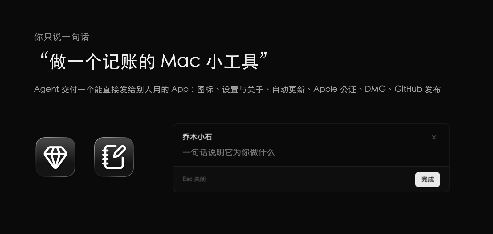
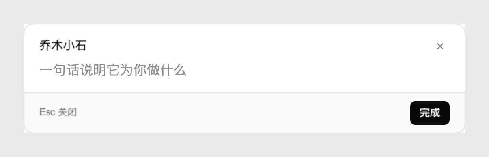
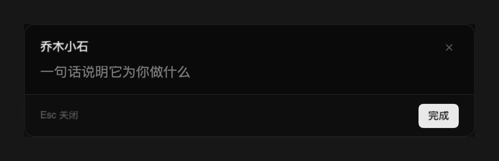
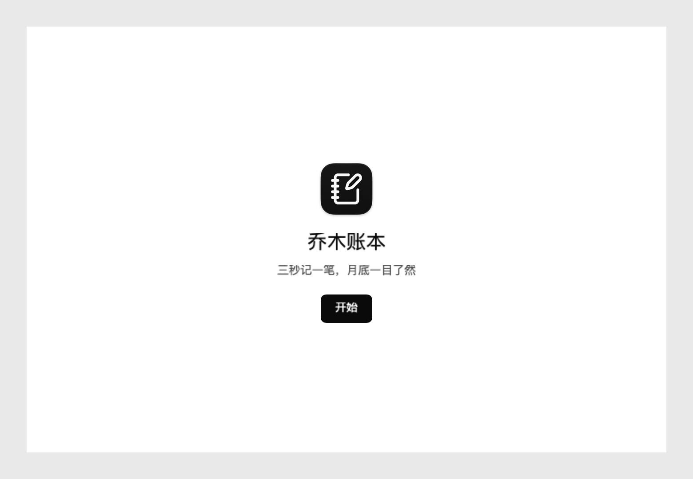
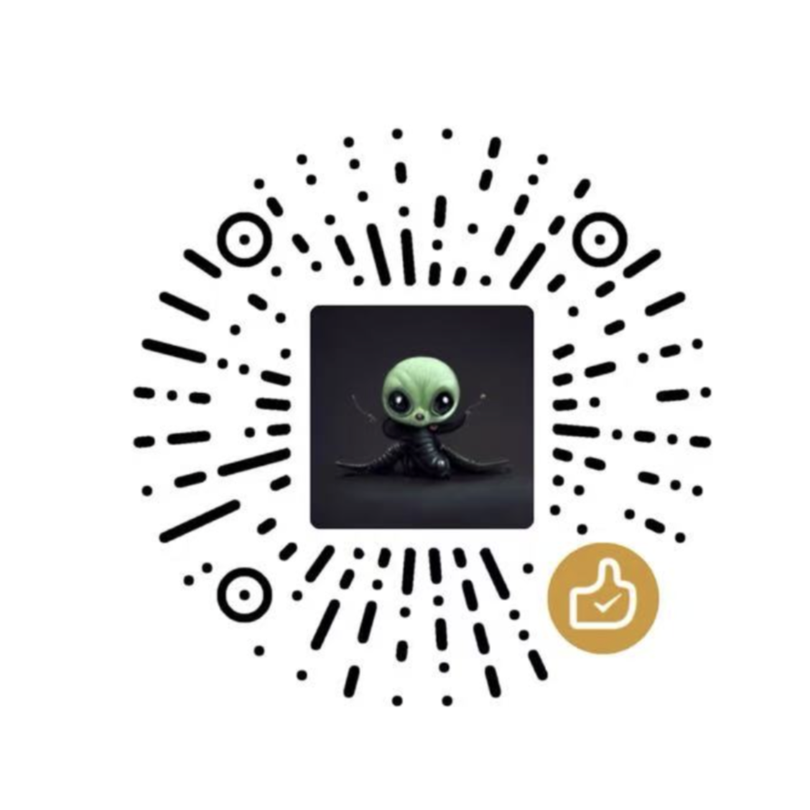

<div align="center">


# 乔木 macOS 开发 · qiaomu-macos-dev

**中文** | [English](#english)

一句话，让 AI Agent 做出一个**能直接发给别人用**的 Mac App。<br>
One sentence in, a polished, notarized, auto-updating Mac app out.


[](LICENSE)



</div>

## 痛点

让 AI 写个 Mac 小工具不难，难的是**把它变成一个产品**：

- 能跑起来，但长得像 2010 年的 demo；
- 没有图标、没有设置页、没有「关于」，用户不知道版本，也找不到你；
- 发给朋友，macOS 提示「无法验证开发者」，直接劝退；
- ⌘V 粘贴不了、快捷键录不上、权限每次重装都要重新给……每个坑都要花一晚上；
- 想更新？只能让用户自己再下载一遍。

这些坑，作者在做 [乔木闪记 Jot](https://github.com/joeseesun/qiaomu-jot) 时一个一个踩过。这个 skill 把整套经验装进了一个脚手架和一份操作手册，让 Agent 一次做对。

## 它交付什么

| 环节 | 你得到的 |
|---|---|
| 脚手架 | SwiftPM 工程（不需要 Xcode 工程），菜单栏形态或普通窗口形态二选一，首次构建即可运行、签名、自检 |
| 图标 | 用 Lucide 图形生成 Icon Composer 图标（macOS 26 Liquid Glass + 旧系统 icns） |
| 界面 | Vercel 黑白风格设计 token、Geist 字体，离屏 `--snapshot` 渲染，**每个界面都看过再交付** |
| 设置 + 关于 | 原生工具栏标签页；关于页含版本、检查更新、反馈、使用说明、源代码、公众号与打赏二维码 |
| 自动更新 | Sparkle 2，EdDSA 签名，GitHub Release 托管 appcast，后台检查只轻提示、不打断 |
| 发布 | Developer ID 签名、通用二进制、Apple 公证、带背景图的 DMG、`install-local.sh` 一键替换本机版本 |
| GitHub | **默认私有仓库**，问过你才公开；产品页式 README（讲痛点、讲价值、配图）、PR 流程、Release |
| 经验库 | 30+ 条真实踩坑（焦点、⌘ 快捷键、输入法、TCC 权限、微信图片、actool、DMG……）和一份交付前细节清单 |

<table>
<tr>
<td></td>
<td></td>
</tr>
<tr>
<td></td>
<td></td>
</tr>
</table>

<sub>以上都是生成器产出的 App 用自带 `--snapshot` 渲染的真实画面，没有 P 图。</sub>

## 安装

```bash
npx skills add joeseesun/qiaomu-macos-dev
```

前提清单：

- [ ] macOS，已装 Xcode 命令行工具（Swift 5.9+、`xcrun actool`；Icon Composer 图标需要 Xcode 26 的 actool）
- [ ] Python 3（生成器和 DMG 打包用）
- [ ] 要给别人用：Apple Developer ID Application 证书（在登录钥匙串里）
- [ ] 要公证：一次性运行 `xcrun notarytool store-credentials notary`（skill 会提示你自己运行，不会代你输入密码）
- [ ] 要发布到 GitHub：已登录的 `gh` CLI

## 你可以直接这样说

- 「做一个 Mac 菜单栏小工具：按 ⌥Space 弹出输入框，记下的内容存到一个 Markdown 文件」
- 「开发一个 macOS app，管理我的提示词库，要好看，要能自动更新」
- 「给这个 Mac app 加一个设置页和关于页，带检查更新」
- 「设计一个 app 图标」「打包成公证过的 DMG」「发布到 GitHub，先私有」
- 「为什么我的菜单栏 app 里 ⌘V 不能粘贴？」

## 工作方式

```
一句话 → 意图（痛点、核心动作、形态）→ new_app.py 脚手架 → 核心功能 + selftest
      → 界面打磨（snapshot 逐张看）→ 设置/关于/引导 → 图标 → 权限 → 本机安装试用
      → GitHub（私有）→ 问你是否公开 → release.sh 公证 + DMG + appcast → 验证下载与更新
```

脚手架可以单独用：

```bash
python3 scripts/new_app.py --dir ~/Code/qiaomu-ledger --name Ledger --zh 乔木账本 \
  --bundle-id ai.qiaomu.ledger --repo joeseesun/qiaomu-ledger \
  --kind window --tagline "三秒记一笔，月底一目了然" --lucide notebook-pen
cd ~/Code/qiaomu-ledger && ./scripts/sparkle-key.sh && ./build.sh && build/Ledger.app/Contents/MacOS/Ledger --selftest
```

## 目录

```
SKILL.md                  路由 + 一句话开发流程 + 不可妥协的规则
references/               one-shot 流程、模板、架构、界面、设置与关于、图标、权限、自动更新、发布、GitHub、踩坑、细节清单
scripts/new_app.py        生成器
assets/template/          App 模板（Swift 源码、build/release/install 脚本、DMG 背景、Sparkle 密钥脚本）
evals/ reports/ tests/    触发评估、Skill IR、生成器单元测试
```

## 安全边界

- Sparkle 私钥只在你的登录钥匙串里，公证凭据在 `notary` 钥匙串配置里；仓库和 skill 中只有公钥。
- Git 只走分支 → PR → 合并，不直接推 main；仓库默认私有，公开、发布 Release 都先问你。
- 生成器只联网下载一个 Lucide 图标 SVG（离线时使用内置图形）。

## 验证

```bash
python3 ~/.claude/skills/qiaomu-meta-skill/scripts/validate_skill.py .
python3 -m unittest discover -s tests
```

本仓库发布前已实测：菜单栏和窗口两种形态都能生成、构建、Developer ID 签名、自检通过、snapshot 正常；`SKIP_NOTARIZE=1 ./release.sh` 产出 DMG。完整公证流程在乔木闪记 1.4.0 / 1.5.0 发布中验证过。

## Troubleshooting

| 现象 | 处理 |
|---|---|
| `build.sh` 在 "Build complete" 后退出，actool 报 `currentDirectoryPath is unexpectedly nil` | 模板会自动重启 `ibtoold` 重试；仍失败就看 `build/actool.log` |
| 每次构建都要重新授权辅助功能 | 没有 Developer ID 证书，退回了 ad-hoc 签名；安装证书后重建 |
| `sparkle-key.sh` 失败 | 再运行一次（新 checkout 的 SwiftPM 缓存竞争），或先 `swift package resolve` |
| 公证失败 | `xcrun notarytool log <id> --keychain-profile notary`，对照 `references/release.md` |
| 关于页二维码是空的 | 没有找到 `qiaomu-profile` 素材，把图片放进 `Resources/About/` |

## 致谢

经验来自 [乔木闪记 Jot](https://github.com/joeseesun/qiaomu-jot) 的完整开发过程。参考研究过的开源 skill：axiom（macOS 平台知识）、dimillian 的 macOS menubar 应用 skill、petekp macos-app-design、openclaw release-openclaw-mac；均为思路借鉴，未复制代码。依赖：[Sparkle](https://sparkle-project.org)（MIT）、[KeyboardShortcuts](https://github.com/sindresorhus/KeyboardShortcuts)（MIT）、[Lucide](https://lucide.dev)（ISC）。

<!-- qiaomu-profile:start -->
## 关于向阳乔木

向阳乔木（乔向阳 / Joe）是一位实践型 AI 产品与内容创作者，长期把前沿 AI 变化转译成可复用的工作流、产品判断、AI 编程实践、AI 搜索实践和 GEO/AI 营销方法。

- 个人网站: https://qiaomu.ai
- 博客: https://blog.qiaomu.ai
- X: https://x.com/vista8
- GitHub: https://github.com/joeseesun/
- 微信公众号: 向阳乔木推荐看

### 支持与关注

| 打赏支持 | 微信公众号 |
|---|---|
|  |  |
| 感谢支持乔木持续分享 AI 实践 | 扫码关注「向阳乔木推荐看」 |

<!-- qiaomu-profile:end -->

## 许可证

MIT © 2026 向阳乔木。生成的 App 模板同样是 MIT；`Resources/About/` 里的二维码归向阳乔木所有，不在 MIT 授权范围内。

---

<a name="english"></a>

# English

**qiaomu-macos-dev** is an agent skill that turns one sentence into a shipped native macOS app: a SwiftPM project (menu bar + hotkey panel, or a regular window app), an Icon Composer icon from Lucide, a settings window with a real About page, Sparkle auto-update fed from GitHub Releases, Vercel-style UI verified with offscreen snapshots, Developer ID signing, notarization and a designed DMG. It also runs the GitHub side: private repo by default (asks before going public), a product-page README, PR-only workflow and releases. A catalog of 30+ real pitfalls (focus, ⌘ keys in non-activating panels, IME, TCC, sandboxed clipboard data, actool, DMG signing) keeps the agent from repeating them.

Install: `npx skills add joeseesun/qiaomu-macos-dev`. Requires macOS with Xcode command line tools; distribution additionally needs a Developer ID certificate and a `notary` keychain profile. Secrets never enter the repo.
